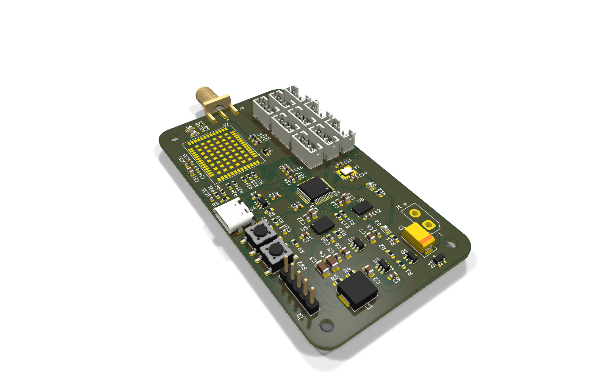
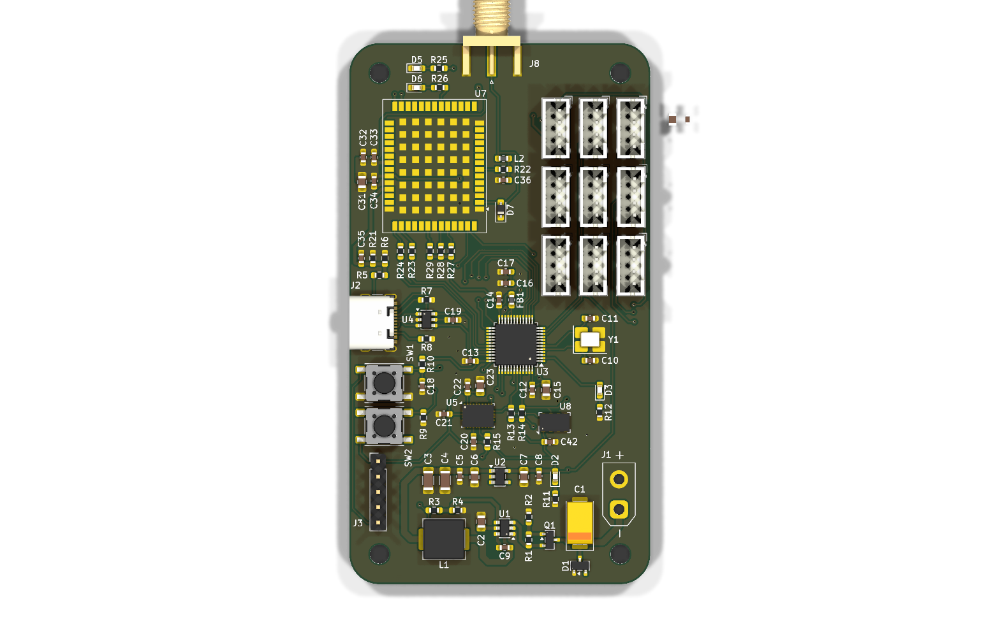
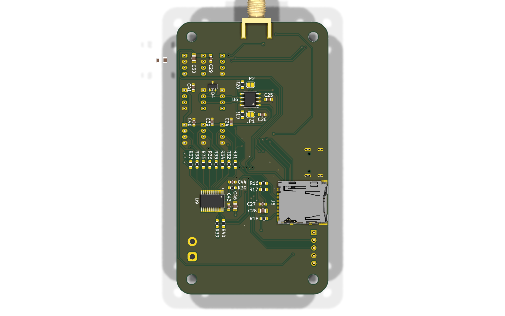

# DAS V2 — Sistema de Aquisição de Dados de Voo
**Equipe de AeroDesign — Temporada 2025/2026**  
*Placa de Aviônica Integrada, Telemetria e Posicionamento GNSS RTK Centimétrico*

[](https://kicad.org)
[-red.svg)](https://www.st.com)
[](https://www.u-blox.com)
[]()

---

## 1. Visão Geral do Projeto

O **DAS V2 (Data Acquisition System V2)** é a nova geração da aviônica de bordo da aeronave da equipe de AeroDesign. 

Projetada a partir do zero para superar as limitações térmicas e de estabilidade da versão anterior (V1), a placa unifica em um único PCB de 4 camadas:
* Processamento matemático de alto desempenho com FPU de ponto flutuante em hardware;
* Posicionamento geodésico centimétrico ($1\text{ cm} - 2\text{ cm}$) via RTK/PPK multibanda;
* Fusão de dados inerciais de 9 graus de liberdade (IMU);
* Telemetria do trem de força elétrico via barramento CAN ligado ao VESC;
* Armazenamento em alta velocidade em cartão MicroSD via SPI com DMA;
* Alimentação chaveada de alta eficiência suportando baterias LiPo 2S a 4S ($7.4\text{ V} - 16.8\text{ V}$) sem aquecimento.

---

## 2. Renders 3D da Placa (PCB 4 Camadas — 50 × 90 mm)

<p align="center">
  
</p>

| Vista Superior (Top — `F.Cu`) | Vista Inferior (Bottom — `B.Cu`) |
| :---: | :---: |
|  |  |

---

## 3. Especificações Técnicas

| Subsistema | Componente / Chip | Características Principais |
| :--- | :--- | :--- |
| **Dimensões / Stackup** | **PCB 4 Camadas** ($50 \times 90\text{ mm}$) | Empilhamento `F.Cu` / `In1.Cu` (GND) / `In2.Cu` (PWR) / `B.Cu`, 128 componentes (passivos 0603 *HandSolder*). |
| **Microcontrolador** | **STM32G431CBT6** (LQFP-48) | ARM Cortex-M4F @ 170 MHz com FPU, 128 kB Flash, 32 kB SRAM, FDCAN nativo, cristal HSE 16 MHz. |
| **GNSS RTK** | **u-blox ZED-F9P-02B** | Receptor multibanda L1/L2 (GPS, GLONASS, Galileo, BeiDou), RTK centimétrico e logs brutos para PPK. |
| **Linha RF GNSS** | Conector SMA Borda 50 $\Omega$ (`J8`) | Bias-T ativo onboard (`VCC_RF`), filtro choke 47 nH e diodo TVS de ultrabaixa capacitância **PESD5V0X1BA**. |
| **IMU (9-DOF)** | **Bosch BNO055** | Acelerômetro, Giroscópio e Magnetômetro com fusão em quatérnions via I2C1 (`0x28`). |
| **Barômetro** | **TE MS5611-01BA** | Sensor barométrico de alta resolução (24 bits) no barramento I2C1 (`0x77`). |
| **Multiplexador I2C** | **TI PCA9548APW** | Multiplexador I2C de 8 canais no barramento I2C3 (`0x70`), com 4 portas JST-PH dedicadas (`J4`, `J12`–`J14`) para Pitot e expansões. |
| **Telemetria VESC / CAN** | **SN65HVD230** + TVS **NUP2105L** | Transceptor CAN 3.3V com terminação split $120\,\Omega$ configurável (`JP1`/`JP2`) e dois conectores JST-PH (`J7` VESC e `J10` Expansão). |
| **Armazenamento** | Slot MicroSD (`J5`, Push-Push) | Interface SPI1 de alta velocidade com DMA (>1.5 MB/s de escrita sustentada), montado na face inferior. |
| **Telemetria RF & Pixhawk** | Conectores JST-PH 2.0 mm (`J6`, `J11`) | UART2 dedicada para rádio modem de longo alcance (`J6`) e UART3 para interface Pixhawk / MAVLink (`J11`). |
| **Interface USB** | Conector USB-C 16 Pinos (`J2`) | Proteção ESD dedicada **USBLC6-2SC6**, resistores CC de $5.1\text{ k}\Omega$ e proteção de sobretensão (`3.3 V`) para `V_USB` do GNSS. |
| **Alimentação** | **TPS563200** + **AP2112K-3.3** | Buck 5.0V @ 2A (eficiência $>90\%$) + LDO 3.3V de baixo ruído, entrada XT30 (`J1`) 7.4V–16.8V (LiPo 2S–4S) com proteção P-MOSFET. |

---

## 4. Arquitetura Estrutural do Repositório

O repositório adota estrutura de **monorepo** separando hardware (KiCad 10), firmware (`STM32G431CBT6`) e documentação:

```
DAS_V2/
├── .gitignore                          # Regras de exclusão de temporários, backups e builds
├── README.md                           # Documentação principal do projeto
├── docs/                               # Documentação Técnica Aprofundada
│   ├── images/                         # Renders 3D da PCB (Top, Bottom e Isométrico)
│   │   ├── das_v2_iso.png
│   │   ├── das_v2_top.png
│   │   └── das_v2_bottom.png
│   ├── GUIA_OPERACAO_RTK_PPK.md        # Guia Completo: Operação RTK, Base de Solo, NTRIP e PPK
│   ├── RELATORIO_AUDITORIA_ESQUEMATICO_DAS_V2.md
│   └── PLANO_DE_ACAO.md                # Diagnóstico forense da V1 e diretrizes do redesenho V2
├── hardware/                           # Projeto KiCad 10 (Esquemático, PCB e Bibliotecas)
│   ├── DAS_V2.kicad_pro                # Arquivo principal do projeto KiCad 10
│   ├── DAS_V2.kicad_sch                # Folha Raiz (Top-Level) com barramentos interfolhas
│   ├── 01_Power_Supply.kicad_sch       # Módulo 1: Entrada XT30, Proteção P-FET, Buck 5V e LDO 3.3V
│   ├── 02_MCU_Core.kicad_sch           # Módulo 2: STM32G431, USB-C, SWD, HSE 16MHz, Reset & Status
│   ├── 03_Sensors.kicad_sch            # Módulo 3: IMU BNO055, Barômetro MS5611 e Mux I2C3 PCA9548APW
│   ├── 04_GNSS_RTK.kicad_sch           # Módulo 4: u-blox ZED-F9P, Bias-T, Linha RF 50R e Porta RTCM
│   ├── 05_Storage_Telemetry.kicad_sch  # Módulo 5: MicroSD, CAN (VESC + Expansão), RF e Pixhawk
│   ├── DAS_V2.kicad_pcb                # Layout da Placa de Circuito Impresso (Stackup 4 camadas)
│   ├── fp-lib-table                    # Tabela de bibliotecas de footprints locais
│   ├── sym-lib-table                   # Tabela de bibliotecas de símbolos locais
│   └── DAS_V2.pretty/                  # Diretório de footprints customizados (Logo AeroDesign)
└── firmware/                           # Firmware embarcado STM32G431CBT6
    └── README.md                       # Mapeamento de periféricos e instruções de firmware
```

---

## 5. Documentação Técnica em Destaque

* 🛰️ **[Guia de Operação GNSS RTK & PPK](docs/GUIA_OPERACAO_RTK_PPK.md):**
  Explica o funcionamento do ZED-F9P, por que o receptor sozinho no avião não atinge precisão centimétrica sem base, como **reaproveitar uma segunda placa DAS V2 idêntica como Estação de Solo em tripé**, como usar a rede gratuita NTRIP/IBGE (RBMC) e o passo a passo de pós-processamento com o **RTKLIB** (PPK).
* 🔍 **[Relatório de Auditoria Elétrica do Esquemático](docs/RELATORIO_AUDITORIA_ESQUEMATICO_DAS_V2.md):**
  Auditoria pino a pino de todos os CIs, apontando as correções críticas de hardware (Zener do P-MOSFET, estabilidade do LDO com cerâmica, bootloader do STM32 vs. CAN RX e capacitância do TVS de RF).
* 📋 **[Plano de Ação e Diagnóstico da V1](docs/PLANO_DE_ACAO.md):**
  Histórico forense das falhas da versão anterior e justificativas de engenharia para cada escolha de arquitetura da V2.

---

## 6. Como Abrir e Compilar o Projeto

1. Certifique-se de ter o **KiCad 10.0** ou superior instalado.
2. Clone o repositório:
   ```bash
   git clone <URL_DO_REPOSITORIO>
   cd "DAS V2"
   ```
3. Abra o arquivo de projeto:
   * Abra o KiCad e selecione `hardware/DAS_V2.kicad_pro`.
   * Clique em `Esquemático (Eeschema)` para visualizar as folhas hierárquicas.
   * Clique em `Placa (Pcbnew)` para visualizar o layout 2D/3D.

---

## 7. Padronização Mecânica e Conectores

Todos os chicotes externos da aeronave foram padronizados para garantir segurança contra vibração, leveza e facilidade de manutenção em campo:

| Conector | Função | Pinos | Padrão |
| :--- | :--- | :---: | :--- |
| **J1** | Entrada de Bateria Principal | 2 | **XT30** Vertical (`AMASS XT30UPB-M`) |
| **J2** | Interface de Programação / Dados | 16 | **USB-C** 2.0 (UFP) |
| **J3** | Debug / Gravação Firmware | 5 | SWD Header 2.54 mm (3.3V, SWDIO, SWCLK, GND, NRST) |
| **J4, J12, J13, J14** | Expansão I2C Multiplexada (Pitot / Sensores) | 4 | **JST-PH 2.0 mm** Vertical (Canais `0..3` do `PCA9548APW`) |
| **J5** | Armazenamento Local | 8+ | Slot **MicroSD** Push-Push (`Hirose DM3AT`, face inferior) |
| **J6** | Telemetria RF de Longo Alcance | 4 | **JST-PH 2.0 mm** Vertical (5.0V, GND, TX, RX — `USART2`) |
| **J7** | Telemetria VESC do Motor | 4 | **JST-PH 2.0 mm** Vertical (NC, CAN_H, CAN_L, GND) |
| **J8** | Antena GNSS Multibanda | Coaxial | **SMA Fêmea** Borda (`Edge-Mount`) 50 $\Omega$ |
| **J9** | Entrada de Correção RTCM | 4 | **JST-PH 2.0 mm** Vertical (3.3V, TX, RX, GND — `UART2` ZED-F9P) |
| **J10** | Expansão Barramento CAN | 4 | **JST-PH 2.0 mm** Vertical (CAN_H, CAN_L, GND) |
| **J11** | Interface Pixhawk / MAVLink | 4 | **JST-PH 2.0 mm** Vertical (`USART3` TX, RX, GND) |

---
*Desenvolvido com excelência técnica pela Equipe AeroDesign.*
