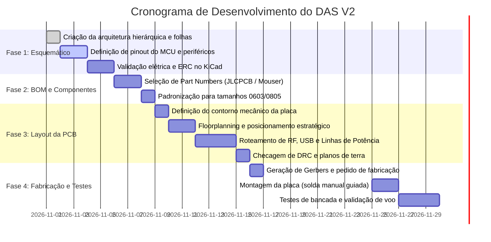

# PLANO DE AÇÃO — REFORMULAÇÃO COMPLETA: SISTEMA DE AQUISIÇÃO DE DADOS (DAS V2)
**AeroDesign — Temporada 2025/2026**

---

## 1. Visão Geral e Objetivos do Projeto

O **DAS V2** (Data Acquisition System V2) é a nova geração da placa de aviônica e aquisição de dados de voo para a aeronave da equipe de AeroDesign. 

O projeto V1 anterior apresentou problemas graves de confiabilidade em bancada (perda definitiva da interface USB após poucos minutos de operação, superaquecimento severo de reguladores lineares e limitações de arquitetura de processamento). O objetivo desta versão V2 é **redesenhar o sistema do zero**, adotando práticas profissionais de engenharia eletrônica, segurança de barramentos, integridade de sinal e facilidade de montagem manual.

### Metas Principais:
1. **Confiabilidade Inabalável:** Eliminação de qualquer risco de sobretensão em barramentos sensíveis (como os $3.6\text{ V}$ máximos do módulo GNSS).
2. **Eficiência Térmica e de Potência:** Substituição dos reguladores lineares por estágio chaveado (Buck), suportando baterias LiPo 2S a 4S ($7.4\text{ V} - 16.8\text{ V}$) sem aquecimento.
3. **Dimensionamento Correto do MCU:** Substituição do obsoleto e massivo STM32F103VET6 (LQFP-100) pelo processador de alta performance **STM32G431CBT6** (ARM Cortex-M4F com FPU por hardware a 170 MHz, FDCAN nativo, pacote compacto LQFP-48).
4. **Interface Unificada USB-C:** Uma única porta USB-C moderna, com proteção ESD dedicada (`USBLC6-2SC6`), resistores de configuração CC (5.1 kΩ) e roteamento differential 90 Ω.
5. **Taxa de Aquisição em Tempo Real & Armazenamento Confiável:** Conexão do módulo RTK GNSS via UART com DMA dedicada e do cartão MicroSD via barramento SPI de alta velocidade com DMA (taxa sustentada >1.5 MB/s, cobrindo com mais de 50x de folga o volume de telemetria de voo).
6. **Telemetria de Propulsão via Barramento CAN (VESC):** Interface CAN 2.0B diferencial dedicada para recepção dos pacotes de telemetria do motor elétrico (ERPM, corrente de fase, corrente de bateria, tensão, duty cycle e temperaturas), dispensando sensores de corrente e tensão pesados na placa.
7. **Padronização de Conectores Mecânicos:** Utilização de conectores **JST-PH 2.0 mm** para todos os periféricos (CAN, telemetria RF, sensores externos e RTCM), garantindo baixo perfil, leveza, trava de atrito e compatibilidade direta com a porta CAN do VESC. Entrada de bateria principal via conector **XT30**.
8. **Manufaturabilidade:** Migração de passivos de 0402 para **0603 / 0805**, viabilizando soldagem e retrabalho manual seguros pela equipe sem risco de pontes de solda ou soldas frias. Placa 100% integrada (sem daughterboards).

---

## 2. Diagnóstico Forense da Versão V1 (Lições Aprendidas)

A auditoria dos arquivos `DAS_V1.kicad_sch` e `DAS_V1.kicad_pcb` revelou as causas exatas das falhas:

| Subsistema | Problema Crítico na V1 | Consequência Real | Solução Definitiva na V2 |
| :--- | :--- | :--- | :--- |
| **USB do GPS (ZED-F9P)** | Pino 38 (`V_USB`) conectado diretamente aos **+5.0V** do VBUS do conector USB. | **Destruição do PHY USB**: O limite absoluto da u-blox é **3.6 V**. A injeção de 5V causou queima do bloco USB em 2 protótipos. | Circuito de sensoriamento de VBUS que entrega **3.3 V chaveado** ao `V_USB`, com resistor pull-down de 100k e filtro RC. |
| **USB do STM32** | Pinos `OSC_IN`/`OSC_OUT` desconectados (sem cristal HSE) e ausência de pull-up de 1.5k no D+. | **Falha de Enumeração**: Clock HSI interno derivou com a temperatura fora da tolerância de ±0.25% exigida pelo protocolo USB Full-Speed. | Uso de MCU com CRS nativo (*Crystal-less USB*) ou cristal externo de precisão 16 MHz / 8 MHz + pull-up interno. |
| **Alimentação** | Entrada de 12V convertida para 5V por LDO linear `LD1117S50` (SOT-223). | **Superaquecimento Extremo**: Dissipação de $1.75\text{ W} - 3\text{ W}$, elevando o die a $>145^\circ\text{C}$ e acionando corte térmico. Uso de cerâmica gerava oscilação por baixo ESR. | Conversor Chaveado Step-Down (Buck) síncrono com eficiência $>90\%$ gerando 5V frio, seguido de LDO de baixo ruído para 3.3V. |
| **Microcontrolador** | STM32F103VET6 (LQFP-100, Cortex-M3 sem FPU). | **Superdimensionado fisicamente e lento**: 60 pinos ociosos, pacote gigante de 14x14mm, emulação de float por software para fusão de sensores. | **STM32G431CBT6** (Cortex-M4F com hardware FPU, 170 MHz, FDCAN nativo, pacote compacto LQFP-48). |
| **Telemetria de Propulsão** | Ausente na V1 (sem leitura de dados do motor). | **Incerteza Operacional**: Sem medição de corrente de pico, consumo real (Ah/Wh) e temperatura do ESC em voo. | **Barramento CAN 2.0B diferencial** ligado ao VESC, com transceptor 3.3V, proteção TVS e conector JST-PH 2.0 mm. |
| **Conectores** | Mistura de pin headers desprotegidos e conectores volumosos. | **Risco de desconexão por vibração** e espaço excessivo na PCB. | **Padronização em JST-PH 2.0 mm** para sinais/CAN/telemetria e **XT30** para alimentação. |
| **Barramento I2C** | 3 pares de resistores em paralelo (`R3/R4`, `R6/R7`, `R9/R10`) totalizando $1.13\text{ k}\Omega$. | Sobrecarga de corrente dos drivers open-drain dos sensores e violação dos limites de $V_{OL}$. | Par único de resistores de pull-up de $2.2\text{ k}\Omega$ ou $4.7\text{ k}\Omega$ na linha I2C. |
| **Linha RF GPS** | Trilha do conector SMA `J2` até o pino 2 do ZED-F9P roteada com 0.19 mm sem blindagem e sem coplanaridade. | Perda de sensibilidade dos sinais de satélite L1/L2 e descasamento de impedância. | Linha de transmissão microfita coplanar com impedância controlada de $50\,\Omega$ e cerca de vias (*via stitching*). |

---

## 3. Divisão Estrutural dos Arquivos KiCad (Arquitetura Hierárquica)

O projeto KiCad do DAS V2 está organizado em **5 folhas hierárquicas modulares**, facilitando o desenvolvimento, revisão e testes independentes de cada bloco:

```
DAS_V2/
├── DAS_V2.kicad_pro              # Arquivo principal do projeto KiCad 10
├── DAS_V2.kicad_sch              # Folha Raiz (Top-Level) com barramentos e interconexões
├── 01_Power_Supply.kicad_sch     # Módulo 1: Entrada, Proteções, Buck 5V e LDO 3.3V
├── 02_MCU_Core.kicad_sch         # Módulo 2: Microcontrolador, USB-C, SWD, Reset & Status
├── 03_Sensors.kicad_sch          # Módulo 3: IMU BNO055 e Conector de Expansão I2C (Pitot)
├── 04_GNSS_RTK.kicad_sch         # Módulo 4: u-blox ZED-F9P, Linha RF 50R, Bias-T e Proteção
├── 05_Storage_Telemetry.kicad_sch# Módulo 5: MicroSD Card (SDIO) e Conector de Telemetria
├── DAS_V2.kicad_pcb              # Placa de Circuito Impresso de 4 camadas
├── sym-lib-table                 # Tabela de bibliotecas de símbolos
├── fp-lib-table                  # Tabela de bibliotecas de footprints
└── DAS_V2.pretty/                # Diretório de footprints customizados (Logo AeroDesign)
```

### Detalhamento das Folhas:

### Folha 1: `01_Power_Supply.kicad_sch` (Alimentação e Proteção)
* **Entrada Principal:** Conector XT30 polarizado para bateria LiPo 2S–4S ($7.4\text{ V} - 16.8\text{ V}$).
* **Proteção contra Inversão de Polaridade:** P-MOSFET com divisor resistivo e diodo Zener de $12\text{ V}$ no Gate (garantindo que $V_{GS}$ nunca ultrapasse os limites máximos de segurança).
* **Estágio Buck 5.0V:** Conversor chaveado step-down de alta eficiência (ex.: TPS563200 / LMR14030 / MP2315) fornecendo 5.0V @ 2A para a placa sem dissipar calor.
* **Comutação Automática USB / Bateria:** Diodo ideal ou MOSFET de comutação que prioriza a bateria e isola o VBUS da porta USB do computador.
* **Estágio LDO 3.3V Limpo:** Regulador linear de baixo ruído e alto PSRR (ex.: AP2112K-3.3 ou MIC5219) alimentando MCU, sensores analógicos e RF.

### Folha 2: `02_MCU_Core.kicad_sch` (Processamento e Conectividade)
* **Microcontrolador:** STM32G431CBT6 (ARM Cortex-M4F com FPU a 170 MHz, 128 kB Flash, 32 kB SRAM, FDCAN nativo, LQFP-48).
* **Interface USB-C:** Conector USB-C de 16 pinos com resistores de $5.1\text{ k}\Omega$ em CC1 e CC2, proteção ESD dedicada (`USBLC6-2SC6`) e linhas D+/D- conectadas aos pinos PA12/PA11.
* **Alocação FDCAN:** Pinos `PB8` (FDCAN1_RX) e `PB9` (FDCAN1_TX), operando simultaneamente com a USB Full-Speed sem conflitos de pinos ou RAM.
* **Debug & Gravação:** Conector SWD padrão (SWDIO em PA13, SWDCLK em PA14, NRST, 3V3, GND).
* **I/O de Operação:** Botão táctil de Reset, botão de usuário/bootloader (BOOT0 com pull-down de 10k), LED RGB inteligente (WS2812B ou LEDs discretos de status) e LED indicador de alimentação 3.3V.

### Folha 3: `03_Sensors.kicad_sch` (Navegação Inercial e Expansão de Telemetria)
* **IMU 9-DOF:** Bosch BNO055 (Acelerômetro 3 eixos, Giroscópio 3 eixos, Magnetômetro 3 eixos com processador Cortex-M0 interno para fusão sensorial em tempo real e saída em quatérnions).
* **Eliminação do Barômetro Onboard (BMP581):** Simplificação arquitetural que elimina o chip LGA-10 microscópico ($2\times 2\text{ mm}$), evitando riscos de montagem manual e erros de pressão estática interna na fuselagem. A altitude geométrica de precisão centimétrica é fornecida diretamente pelo receptor u-blox ZED-F9P RTK.
* **Barramento I2C:** Par único de resistores de pull-up ($2.2\text{ k}\Omega$) para 3.3V (conectado aos pinos PB6/PB7 do MCU).
* **Conector de Expansão I2C:** Conector **JST-PH 2.0 mm (4 pinos)** para acoplamento do sensor de pressão diferencial (Tubo de Pitot externo para medição de velocidade indicada e dados atmosféricos).

### Folha 4: `04_GNSS_RTK.kicad_sch` (Posicionamento de Alta Precisão)
* **Receptor GNSS:** u-blox ZED-F9P-02B (Receptor RTK multibanda L1/L2 com precisão centimétrica).
* **Circuito de Proteção do Pino `V_USB`:**
  * Divisor resistivo / transistor chaveador que aplica rigorosamente **3.3 V** no pino 38 somente quando o cabo USB estiver inserido.
  * Resistor pull-down de $100\text{ k}\Omega$ para GND para garantir nível lógico zero ao desconectar.
* **Comunicação Principal:** UART conectada diretamente ao MCU com linhas TX/RX dedicadas para DMA.
* **Antena RF & Bias-T:** Conector SMA fêmea de borda, indutor de RF de 47 nH e resistor limitador de corrente para alimentação da antena ativa através de `VCC_RF`.
* **Entrada de Correção RTK:** Conector **JST-PH 2.0 mm (4 pinos)** dedicado para entrada de mensagens RTCM (via rádio base de solo).

### Folha 5: `05_Storage_Telemetry.kicad_sch` (Gravação, Telemetria RF e CAN VESC)
* **Armazenamento:** Slot para cartão MicroSD com filtragem de desacoplamento reforçada ($10\,\mu\text{F} + 100\,\text{nF}$) operando via barramento SPI de alta velocidade com DMA (linhas `SD_SCK`, `SD_MOSI`, `SD_MISO`, `SD_CS`).
* **Telemetria de Voo RF:** Conector **JST-PH 2.0 mm (4 ou 6 pinos)** para rádio modem de longo alcance (ex.: LoRa SX1262, RFD900 ou Holybro Telemetry) ligado à UART2 do MCU.
* **Interface de Barramento CAN (VESC):**
  * Transceptor CAN 3.3V de alta velocidade (Texas Instruments **SN65HVD230DR** ou similar).
  * Diodo TVS duplo dedicado para proteção de barramento contra transientes e ESD (**PESD2CAN** ou **NUP2105L** em SOT-23).
  * Terminação de $120\,\Omega$ split ($2\times 60\,\Omega + 4.7\,\text{nF}$ para terra) com *jumper* de solda para ligar/desligar.
  * Conector **JST-PH 2.0 mm (4 pinos)** no padrão VESC: Pino 1 (+5V_AUX com jumper aberto), Pino 2 (CAN_H), Pino 3 (CAN_L), Pino 4 (GND).

---

## 4. Regras de Design e Roteamento para a Placa de Circuito Impresso (PCB V2)

### Empilhamento (Stackup de 4 Camadas Recomendado):
1. **Top Layer (F.Cu):** Sinais de alta velocidade, RF do GPS, cristais, componentes e trilhas curtas.
2. **Inner Layer 1 (In1.Cu):** **Plano de Referência GND SÓLIDO E CONTÍNUO** (essencial para retorno de alta frequência e blindagem).
3. **Inner Layer 2 (In2.Cu):** Malha de alimentação (+3.3V e +5V) e sinais não críticos.
4. **Bottom Layer (B.Cu):** Trilha de alimentação secundária e sinais de baixa velocidade.

### Regras Críticas de Roteamento:
* **RF da Antena GPS (50 Ω):** A trilha entre o conector SMA e o pino 2 do ZED-F9P deve ser modelada como uma **Guia de Onda Coplanar com Plano de Terra** (*Coplanar Waveguide with Ground*). Deve ter plano de terra contínuo imediatamente abaixo (In1.Cu) e fileira de vias de aterramento (*via stitching*) espaçadas a no máximo 1 mm ao longo de ambos os lados da trilha.
* **Par Diferencial USB (90 Ω):** As linhas D+ e D- devem correr em par acoplado, com comprimento rigidamente casado ($\Delta L < 0.15\text{ mm}$), evitando curvas de 90° e passando diretamente pelo chip de proteção ESD `USBLC6-2SC6`.
* **Desacoplamento:** Cada pino de VDD do MCU e dos sensores deve ter seu capacitor de 100 nF posicionado a menos de 2 mm do pad, com a via para o plano de terra colocada imediatamente após o capacitor.
* **Térmica do Conversor Buck:** Colocar planos de cobre generosos com pelo menos 4 a 6 vias térmicas conectadas aos planos internos de GND sob os pads de dissipação do indutor e do regulador.

---

## 5. Cronograma e Fases de Execução



---

## 6. Lista de Verificação Pré-Fabricação (Checklist de Ouro)

- [ ] **Pino 38 (`V_USB`) do ZED-F9P:** Tensão verificada em $\le 3.3\text{ V}$ em qualquer cenário de conexão?
- [ ] **Clock do MCU:** Cristal HSE previsto no circuito ou modo CRS validado para o chip selecionado?
- [ ] **Alimentação:** Corrente máxima do estágio Buck dimensionada com folga de pelo menos 50%?
- [ ] **Pull-ups de I2C:** Existe apenas um único par de resistores no barramento compartilhado?
- [ ] **RF 50 Ω:** Impedância da trilha de antena calculada de acordo com o stackup exato do fabricante da PCB?
- [ ] **Barramento CAN:** Transceptor 3.3V com proteção TVS PESD2CAN, terminação split 120 Ω configurável e isolamento do pino +5V do VESC?
- [ ] **Padronização Mecânica:** Todos os conectores de chicotes externos usam footprint JST-PH 2.0 mm com indicação clara de pinagem na serigrafia?
- [ ] **Soldabilidade Manual:** Todos os componentes passivos discretos são 0603 ou maiores com pads *HandSolder*?
- [ ] **Proteção de Inversão:** O limite de tensão Gate-Source ($V_{GS}$) do MOSFET está protegido com zener/divisor?

---
*Documento aprovado para a reformulação do projeto DAS V2 da Equipe AeroDesign.*
